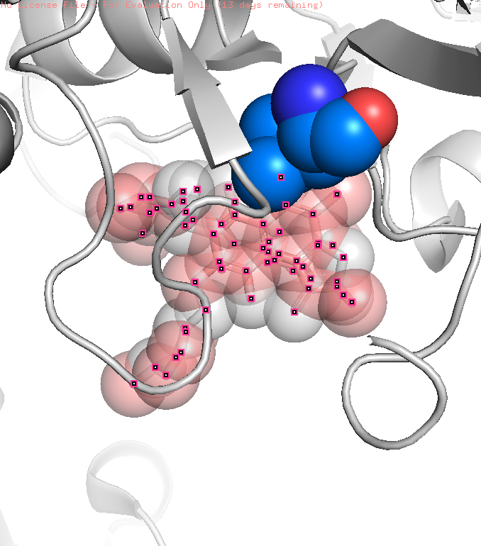

# The 3D Molecular Inspector: Structural Pharmacology & Interactome Modeling

An automated computational biology pipeline investigating the biophysical basis of Rifampicin resistance in the *Mycobacterium tuberculosis* RNA Polymerase transcription complex (PDB: 5UHC) and mapping functional interactome hubs.

---

## Biological Context & Mechanism
Rifampicin (RFP) is a cornerstone first-line antibiotic against *Mycobacterium tuberculosis* that functions by physically blocking the elongating RNA transcript pathway adjacent to the catalytic site of RNA polymerase (beta subunit, encoded by *rpoB*). 

Clinical resistance arises predominantly via single amino acid substitutions within the 81-bp Rifampicin Resistance-Determining Region (RRDR). This pipeline parses atomic coordinates, identifies contact residues, models steric clashes caused by the canonical **Ser450Leu** mutation (crystallographic index **SER456** in 5UHC), and maps functional network hubs.

---

## Key Biophysical Findings

| Feature | Coordinate / Target | Observed Metric | Biophysical Significance |
| :--- | :--- | :--- | :--- |
| **Primary Contact** | Chain C: SER456 | **2.43 Å** | Direct high-affinity hydrogen bond between wild-type Serine hydroxyl and Rifampicin. |
| **Pocket Boundary** | Chain C & F Contacts | **< 5.0 Å** | Catalytic cage residues identified via KD-tree: PHE439 (2.68 Å), ARG454 (3.06 Å), GLN438 (3.07 Å), ASP441 (3.14 Å). |
| **Resistance Clash** | Ser456Leu Variant | **< 2.8 Å** | Replacing Serine with a bulky isobutyl side chain (`-CH(CH3)2`) produces severe van der Waals overlap, expelling the drug. |
| **Core Transcription Hubs** | STRING Network | **Score >= 0.99** | Isolated the functional holoenzyme complex (*rpoA*, *rpoC*, *rpoZ*, *sigA*, *rbpA*, *carD*). |

---

## Structural Clash Figure



*Figure: Rifampicin (RFP) in the RNA polymerase beta-subunit pocket with the Ser456Leu steric clash highlighted in red.*

## Repository Structure

```text
molecular-inspector/
|-- data/
|   |-- 5uhc.cif                # Macromolecular coordinate file (mmCIF)
|   `-- rpoB_interactome.tsv    # STRING functional interaction network
|-- figures/
|   |-- molecular_steric_clash.png # Rendered 3D binding pocket and clash model
|   `-- rpoB_5UHC_clash.pse       # PyMOL session for interactive inspection
|-- src/
|   |-- inspector.py            # Coordinate parser & KD-tree pocket scanner
|   |-- network_builder.py      # STRING REST API client & hub ranker
|   `-- render_clash.pml        # Automated PyMOL visualization script
|-- .gitignore
|-- requirements.txt
`-- README.md
